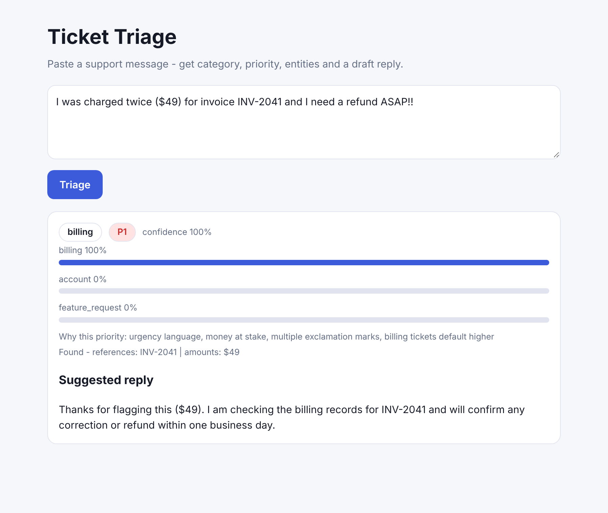

# Ticket Triage

Support inboxes drown in messages that need three different things: sorting, prioritising and a first reply. **Ticket Triage classifies an incoming message,
scores its urgency with an explanation, pulls out the invoice numbers / amounts / emails, drafts a reply - and learns from every correction.**
Node.js, **zero dependencies**, one HTML page.



Real API response for `I was charged twice ($49) for invoice INV-2041 and I need a refund ASAP!!`:

```json
{ "category": "billing", "confidence": 1,
  "priority": { "level": "P1", "score": 7,
    "reasons": ["urgency language", "money at stake", "multiple exclamation marks", "billing tickets default higher"] },
  "entities": { "emails": [], "references": ["INV-2041"], "amounts": ["$49"] },
  "suggestedReply": "Thanks for flagging this ($49). I am checking the billing records for INV-2041 and will confirm any correction or refund within one business day.",
  "needsHuman": false }
```

## Components
| File | What it does |
| --- | --- |
| `src/classifier.js` | **Multinomial Naive Bayes** from scratch (unigrams + bigrams, Laplace smoothing, softmax probabilities, leave-one-out evaluation). Categories: billing, bug, how_to, account, feature_request, else `other`. |
| `src/priority.js` | Transparent additive P1-P4 score: urgency words, security/fraud signals, money at stake, negative sentiment, `!!`, ALL CAPS, category weight - **and it returns the reasons**. |
| `src/entities.js` | Emails, references (`INV-2041`, `#98765`, `ORD-...`), amounts (`$49.99`, `120 dollars`) and per-category reply templates that reuse them. |
| `src/triage.js` | Service: `triage(text)` and `feedback(text, category)` - corrections are persisted to `data/feedback.json` and learned **immediately** (online update), surviving restarts. |
| `src/server.js` | `POST /triage`, `POST /feedback`, `GET /health`, UI at `/`; 400 / 404 / 413 handling, 50 kB body cap. |

## Honest accuracy
The bundled set is **60 short hand-written tickets** (12 per class). Leave-one-out accuracy is about **68%** - enough to demonstrate the pipeline, not enough for production. Naive Bayes is also
over-confident (probabilities cluster at 0 or 1), so `needsHuman` flags low-confidence cases and unknown vocabulary falls back to `other`. The intended loop is: deploy, let agents correct
labels through `/feedback`, and watch accuracy climb; swap in embeddings or an LLM classifier behind the same `classify()` interface when you have the data.

## Run
```bash
npm start                  # http://localhost:3000
npm test                   # 9 tests with node:test, incl. an HTTP round trip and persistence of feedback
curl -s localhost:3000/triage -d '{"text":"The app crashes when I upload a file"}'
curl -s localhost:3000/feedback -d '{"text":"flux capacitor overheats","category":"bug"}'
```
Requires Node 18+. The earlier MERN budget-tracker scaffold in this repository was removed (it was an empty Express/Mongoose stub).
